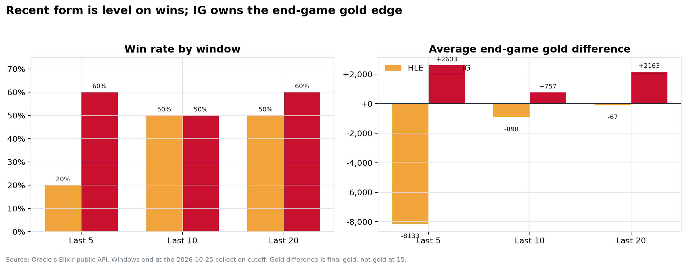
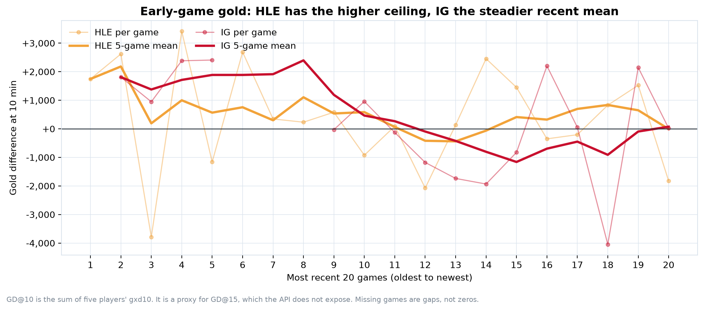
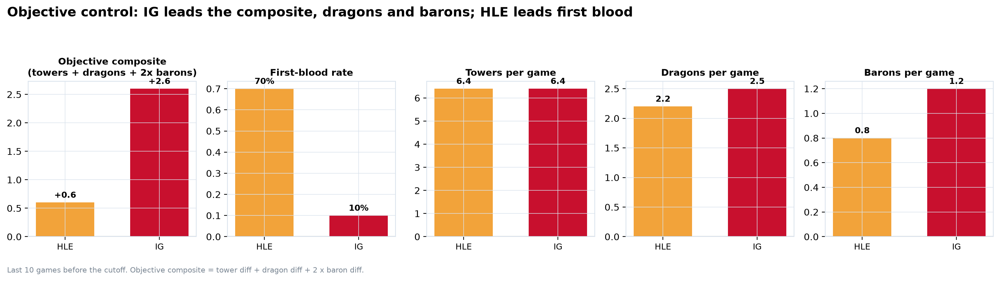
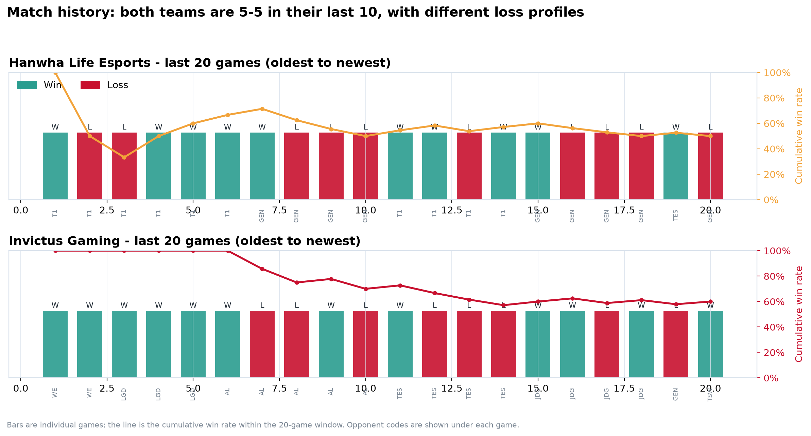
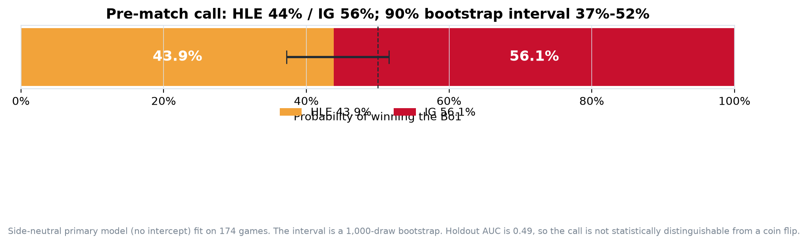
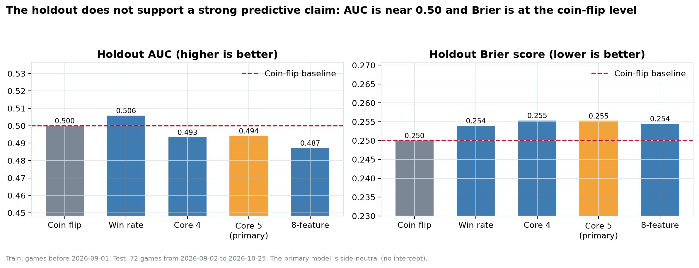
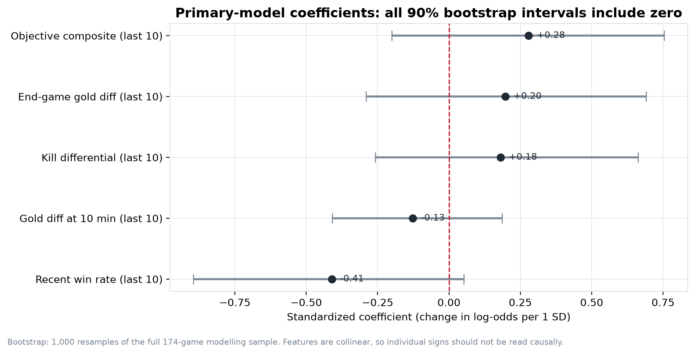
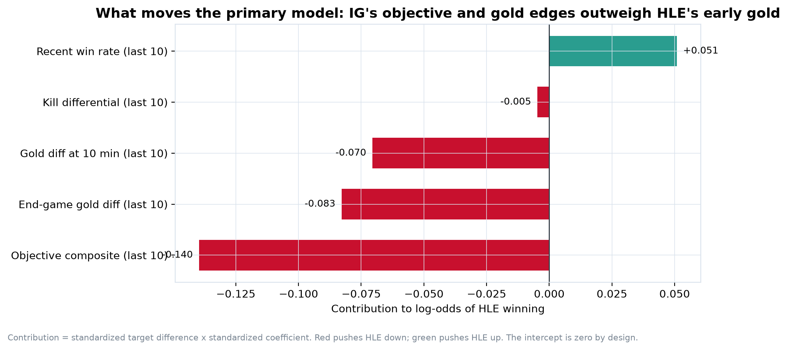
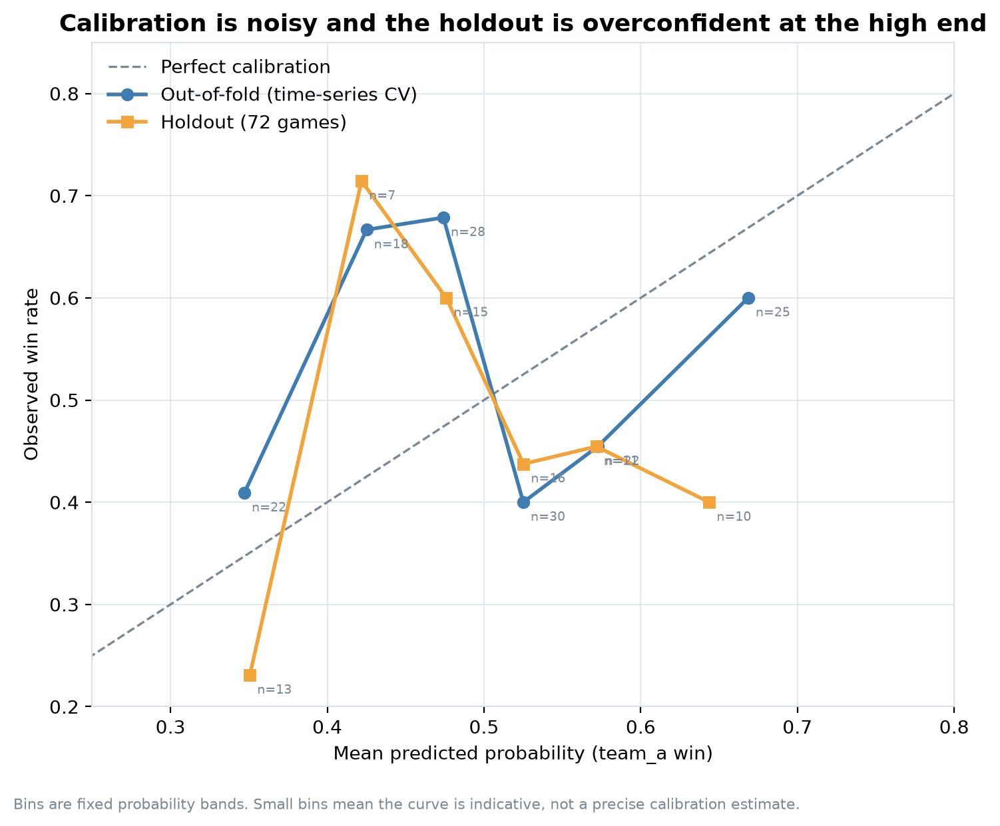
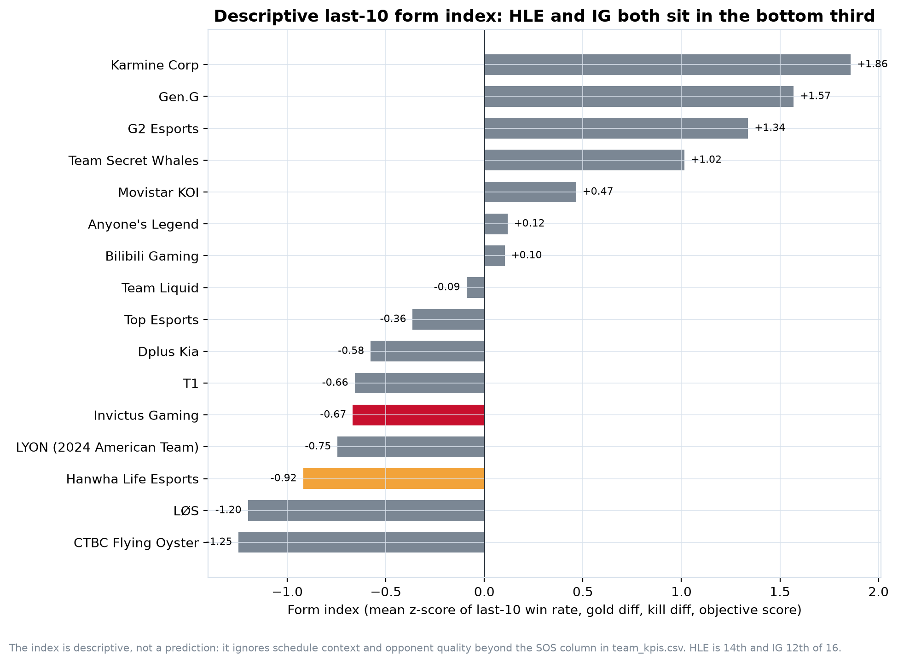

# Executive Report — HLE vs IG, Worlds 2026 Swiss Day 3

**Prepared:** 2026-10-25, 16:48 UTC (before the 17:00 UTC start)
**Data cutoff:** 2026-10-25 16:20 UTC
**Match:** Hanwha Life Esports vs Invictus Gaming — best of 1
**Event:** Worlds 2026, Swiss Day 3
**Oracle's Elixir match ID:** `115660540726095045`
**Status at collection:** `unstarted`

---

## 1. Executive summary

**The call:** **IG 56.1% / HLE 43.9%** under the primary model. The 90% bootstrap interval for HLE is **37.2%–51.6%**, so the result is statistically indistinguishable from a coin flip.

**Why the lean to IG:** IG has the stronger last-10 end-game and objective profile. HLE has the better early game and first-blood rate. The model weights IG's objective composite and end-game gold difference more heavily than HLE's early gold edge, producing a modest IG lean.

**Why you should not over-trust it:** the chronological holdout does **not** support a strong predictive claim. The primary model's AUC is **0.494**, its Brier score is **0.255** versus a **0.250** coin-flip baseline, and its log loss is **0.703** versus **0.693**. The honest conclusion is a close match with a slight IG lean, not a confident forecast.

**Decision recommendation:** treat this as a **coin-flip match with a marginal IG edge**. If a decision requires a single directional call, take **IG**, but size the confidence as low and document the uncertainty. Do not use this model as a stand-alone betting or selection tool.

---

## 2. Match context

| Item | Detail |
|---|---|
| HLE Swiss record | 1–1 (beat Top Esports, lost to Gen.G) |
| IG Swiss record | 1–1 (lost to Gen.G, beat Team Secret Whales) |
| HLE regional path | LCK 2026 runner-up |
| IG regional path | LPL 4th seed via Regional Finals runner-up |
| Head-to-head in sample | **None** |
| Patch | 16.20 for both teams' Worlds games |
| Rest | HLE ~18.6 hours; IG ~19.7 hours before start |
| Format | Bo1 — maximum variance |

The match is a clash of styles rather than a clash of recent records: both teams are 5–5 in their last 10. HLE's recent sample includes LCK playoff games against Gen.G and T1; IG's includes the LPL Grand Finals and Regional Finals.

---

## 3. Data and method

### 3.1 Data

- **Source:** Oracle's Elixir public API (the same data that powers `oracleselixir.com`). The downloadable CSV was unavailable because the Google Drive quota was exceeded; the API fallback is documented in the collection manifest.
- **Coverage:** 16 Worlds 2026 teams, 636 unique completed games, 1,272 team-game rows, up to 50 recent games per team.
- **Cutoff:** every feature uses only games starting before **2026-10-25 16:20 UTC**.
- **Leakage control:** the target match is explicitly excluded from the fact table, the model dataset, and the validation checks.
- **Sampling caveat:** the 50-game seeding is expanded by opponents' lists, so the union is not a complete season game graph. HLE has 65 games in the union; IG has 50.

### 3.2 KPIs

| KPI | Definition | Why it matters |
|---|---|---|
| Win rate (last 5/10/20) | wins ÷ games | Form, but opponent-blind |
| GD@10 | mean sum of five players' `gxd10` | Early-game control; proxy for GD@15 |
| End-game gold diff | mean final gold difference | Conversion and macro close-out |
| Kill differential | mean kills − deaths | Fighting efficiency |
| Objective composite | tower diff + dragon diff + 2 × baron diff | Map control |
| First-blood rate | share of games with first blood | Early skirmish initiative |
| Strength of schedule | mean opponent pre-game 10-game win rate | Context for form |
| Event objective rates | OE stage aggregates (FB%, FT%, FD%, DRG%, BN%) | Historical stage profile |

`GD@15` is not exposed by the API. GD@10 is used as a clearly labeled proxy. Event-level objective rates are stage aggregates and are **not** model features.

### 3.3 Model

- **Sample:** 222 games between Worlds teams; **174** with at least five prior games and complete features.
- **Split:** chronological. Train = 102 games before 2026-09-01; test = 72 games from 2026-09-02 to 2026-10-25.
- **Features (primary):** last-10 differences in win rate, GD@10, end-game gold diff, kill differential, objective composite.
- **Estimator:** L2 logistic regression, standardized features, `C=0.5`, no intercept.
- **Side-neutral design:** historical `team_a` is always blue, but the target side is unconfirmed. Removing the intercept avoids baking the training period's blue-side rate into an unknown-side match.
- **Uncertainty:** 1,000-draw bootstrap of the full modelling sample.
- **Sensitivity:** 4-feature, 5-feature, and 8-feature models; C sensitivity; side-prior scenarios; edge-neutralization scenarios.

---

## 4. Evidence

### 4.1 Recent form is level

| Window | HLE | IG |
|---|---:|---:|
| Last 5 | 1–4 (20%) | 3–2 (60%) |
| Last 10 | 5–5 (50%) | 5–5 (50%) |
| Last 20 | 10–10 (50%) | 12–8 (60%) |
| vs Worlds teams (sample) | 34–22 (60.7%) | 7–9 (43.8%) |
| Worlds 2026 Main Event | 1–1 | 1–1 |

**Read:** the 10-game window is dead level. The 20-game and top-16 records favor HLE; the 5-game window favors IG. This is exactly the kind of conflicting signal that should produce a low-confidence forecast.

### 4.2 HLE owns the early game

| Last-10 metric | HLE | IG | Edge |
|---|---:|---:|---|
| GD@10 | **+202** | **−544** | HLE +746 |
| First-blood rate | **70%** | **10%** | HLE +60 pp |
| Average duration | **31.8 min** | **33.6 min** | HLE faster |
| Kill differential | −1.7 | −2.2 | HLE +0.5 |

HLE's early gold and first-blood profile is clearly better. The caveat: HLE's last-10 GD@10 mean is only +202 despite a 70% first-blood rate, which suggests the early leads are not always converted.

### 4.3 IG owns the end-game and objectives

| Last-10 metric | HLE | IG | Edge |
|---|---:|---:|---|
| End-game gold diff | **−898** | **+757** | IG +1,655 |
| Objective composite | **+0.6** | **+2.6** | IG +2.0 |
| Towers per game | 6.4 | 6.4 | Tie |
| Dragons per game | 2.2 | 2.5 | IG +0.3 |
| Barons per game | 0.8 | 1.2 | IG +0.4 |

IG's end-game gold and objective numbers are the strongest single argument for an IG lean. The objective composite is the largest negative contributor to HLE's model probability (−0.140 log-odds), followed by end-game gold (−0.083).

### 4.4 Match history

Both teams are 5–5 in their last 10, but the loss profiles differ. HLE's recent losses include three straight to Gen.G in the LCK playoffs and a Worlds loss to Gen.G; IG's recent losses include the LPL Grand Finals split and a Regional Finals series loss to Top Esports.

### 4.5 Event-level profile

| Event | Team | GP | W–L | GSPD | EGR | MLR | FB% | FT% | FD% | DRG% | BN% |
|---|---|---:|---:|---:|---:|---:|---:|---:|---:|---:|---:|
| Worlds 2026 Main Event | HLE | 2 | 1–1 | +5.7% | 51.6 | −1.6 | 50 | 50 | 50 | 29 | 50 |
| Worlds 2026 Main Event | IG | 2 | 1–1 | −3.2% | 63.8 | −13.8 | 50 | 100 | 50 | 38 | 50 |
| LCK 2026 Season Playoffs | HLE | 17 | 8–9 | −3.2% | 49.5 | −2.4 | 76 | 53 | 41 | 56 | 56 |
| LCK 2026 Rounds 3–4 | HLE | 21 | 11–10 | +2.7% | 56.5 | −4.1 | 43 | 57 | 62 | 48 | 44 |
| LPL 2026 Grand Finals | IG | 20 | 14–6 | +5.2% | 81.2 | +2.1 | 69 | 75 | 60 | 57 | 58 |
| LPL 2026 Regional Finals | IG | 8 | 4–4 | +2.5% | 43.1 | +6.9 | 0 | 25 | 50 | 52 | 79 |
| LPL 2026 Split 3 | IG | 15 | 9–6 | +2.7% | 54.0 | +9.6 | 67 | 73 | 53 | 63 | 63 |

**Read:** the Worlds samples are only two games per team, so they are anecdotal. The larger stage samples show IG with the stronger gold-share and EGR profile in the LPL Grand Finals, but a much weaker Regional Finals profile. HLE's LCK playoffs were negative on GSPD and EGR. Event aggregates are context, not model inputs.

---

## 5. Prediction and uncertainty

### 5.1 Primary output

| | HLE | IG |
|---|---:|---:|
| Primary probability | **43.9%** | **56.1%** |
| 90% bootstrap interval (HLE) | **37.2%–51.6%** | — |
| Bootstrap median (HLE) | 44.2% | — |

### 5.2 Model comparison

| Model | Features | Holdout AUC | Brier | Log loss | Accuracy |
|---|---:|---:|---:|---:|---:|
| Coin flip | 0 | 0.500 | **0.250** | **0.693** | 45.8% |
| Win rate only | 1 | 0.506 | 0.254 | 0.701 | 47.2% |
| Core 4 | 4 | 0.493 | 0.255 | 0.704 | 47.2% |
| **Core 5 (primary)** | **5** | **0.494** | **0.255** | **0.703** | **47.2%** |
| 8-feature sensitivity | 8 | 0.487 | 0.254 | 0.702 | 45.8% |

The coin flip wins on Brier and log loss. The primary model has a tiny AUC advantage over 0.500 but a worse Brier and log loss. This is a **negative result** and should be presented as such.

### 5.3 Why the model leans IG

The target feature contributions to the primary model's log-odds:

| Feature | HLE − IG | Standardized value | Coefficient | Log-odds contribution | Effect |
|---|---:|---:|---:|---:|---|
| Objective composite | −2.0 | −0.50 | +0.279 | **−0.140** | Pushes HLE down |
| End-game gold diff | −1,655 | −0.42 | +0.197 | **−0.083** | Pushes HLE down |
| GD@10 | +746 | +0.56 | −0.127 | **−0.070** | Pushes HLE down |
| Kill differential | +0.5 | −0.03 | +0.181 | −0.005 | Neutral |
| Recent win rate | 0.0 | −0.12 | −0.410 | +0.051 | Slightly up |
| **Net** | | | | **−0.247** | **P(HLE) = 43.9%** |

The negative GD@10 coefficient is counterintuitive and is a symptom of collinearity: win rate, gold diff, kill diff, and objective composite correlate at **0.83–0.94**. All individual 90% bootstrap intervals include zero. Do not interpret the signs causally.

### 5.4 Calibration

The holdout is overconfident at the high end: predictions in the 0.55–0.60 bin won 45.5% of the time, and predictions above 0.60 won 40.0% of the time. The out-of-fold curve is also noisy. With 72 test games and 33 positives, calibration estimates have wide sampling error.

### 5.5 Scenarios

| Scenario | P(HLE) | P(IG) | Interpretation |
|---|---:|---:|---|
| Coin flip | 50.0% | 50.0% | No-information baseline |
| **Primary (core 5)** | **43.9%** | **56.1%** | Side-neutral, no intercept |
| Core 4 | 45.6% | 54.4% | Drops objective composite |
| 8-feature sensitivity | 44.6% | 55.4% | Adds FB, duration, SOS |
| Win-rate only | 49.7% | 50.3% | Form-only baseline |
| HLE blue-side prior | 48.4% | 51.6% | Adds observed 54.6% blue-side rate |
| HLE red-side prior | 39.4% | 60.6% | Adds observed 45.4% red-side rate |
| Neutralize IG end-game edges | 47.9% | 52.1% | Sets gold diff and objective diff to zero |
| Neutralize HLE early edge | 45.7% | 54.3% | Sets GD@10 diff to zero |

**Side assignment matters more than the form signal.** If HLE is confirmed blue side, the call moves to nearly even. If HLE is red side, IG becomes a clearer favorite. The match record lists HLE as team1 and IG as team2, but blue/red assignment was not confirmed in the pre-match data; do not assume team1 = blue without verification.

### 5.6 Form ranking

The descriptive last-10 form index (mean z-score of win rate, gold diff, kill diff, objective score) ranks HLE **14th of 16** and IG **12th of 16**. This is consistent with the model's modest IG lean, but it also shows that neither team enters the match in strong form.

---

## 6. What would change the call

1. **Confirmed side assignment.** If HLE is blue, the estimate moves from 43.9% to 48.4%; if red, to 39.4%. This is the largest single sensitivity.
2. **Roster/news verification.** The model has no roster, injury, or substitution data. A late roster change would invalidate the form inputs.
3. **Draft.** The model is draft-agnostic. A draft with a decisive early-game or scaling advantage could move the true probability by more than the form signal.
4. **Patch.** Both teams' Worlds games are on patch 16.20; a patch change would weaken the relevance of the last-10 sample.
5. **Market odds.** The model is not calibrated against a market. If a liquid market is available, it is likely a better probability estimate than this 174-game model.

---

## 7. Limitations and risks

- **Weak holdout:** AUC 0.494 and Brier 0.255 vs 0.250 coin flip. The model is a structured baseline, not a reliable predictor.
- **Partial data:** last-50-game seeding, not complete season data.
- **No head-to-head:** HLE and IG did not play in the collected sample.
- **Collinearity:** the five features overlap heavily; coefficient signs are unstable.
- **Small test set:** 72 games; metric uncertainty is wide.
- **No side confirmation:** the primary model is side-neutral by design.
- **Stage aggregates:** event objective rates are not game-level features.
- **Bo1 variance:** a single game is inherently high-variance.
- **No betting recommendation:** this is an analytics exercise, not financial advice.

---

## 8. Post-match validation

The prediction must be scored after the match. The validation plan is in [`post_match_validation_plan.md`](post_match_validation_plan.md). Minimum steps:

1. Record the actual winner, duration, side assignment, patch, and final score.
2. Compute the single-match Brier score: `(p_HLE − actual_HLE)^2`.
3. Append the result to a running validation log.
4. Recompute calibration after every 10–20 matches; do not tune on a single result.
5. Update the Power BI "Prediction & Validation" page with the actual outcome.

For this match, a single Brier score of 0.31 (HLE win) or 0.19 (IG win) is expected under the primary model. One match is not evidence for or against the model; the running log is.

---

## 9. Artifact index

| Artifact | Path |
|---|---|
| Cleaned team-game fact | `data/processed/fact_team_games.csv` |
| Game dimension | `data/processed/dim_games.csv` |
| Rolling team form | `data/processed/team_form.csv` |
| Model dataset | `data/processed/model_dataset.csv` |
| Team KPIs | `data/processed/team_kpis.csv` |
| Match KPIs | `data/processed/match_kpis.csv` |
| Target features | `data/processed/target_match_features.csv` |
| Model comparison | `data/processed/model_comparison.csv` |
| Coefficients | `data/processed/model_coefficients.csv` |
| Calibration | `data/processed/model_calibration.csv` |
| Prediction summary | `data/processed/prediction_summary.json` |
| Scenarios | `data/processed/scenario_analysis.csv` |
| Feature contributions | `data/processed/target_feature_contributions.csv` |
| Validation report | `data/processed/validation_report.json` |
| Charts | `figures/01_*.png` … `figures/10_*.png` |
| Power BI tables | `data/powerbi/*.csv` |
| Power BI guide | `powerbi/dashboard_guide.md` |
| DAX measures | `powerbi/dax_measures.md` |
